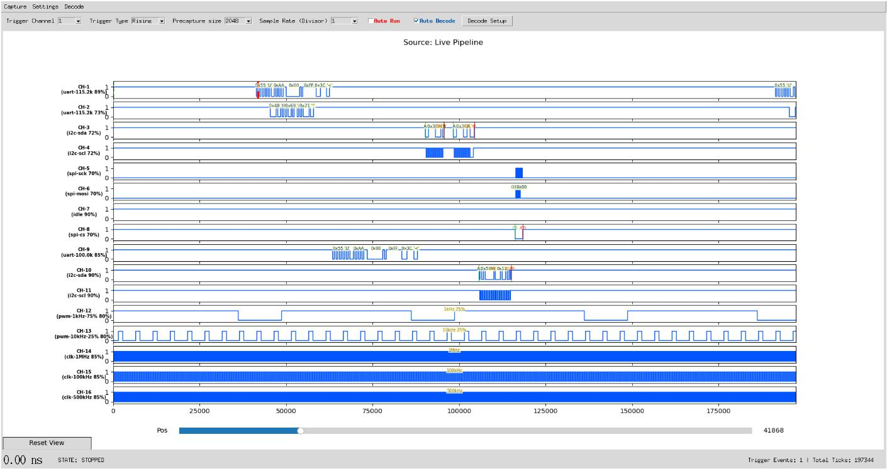
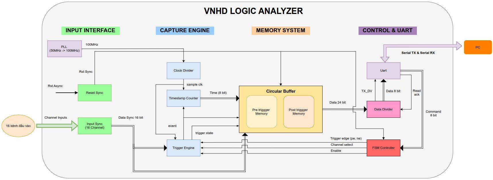

# Máy phân tích logic trên FPGA

**16 kênh · Tốc độ lấy mẫu tới 100 MSa/s · Giải mã UART / I2C / SPI · Giao diện Python**

Dự án máy phân tích logic sử dụng FPGA Intel Cyclone IV và ứng dụng máy tính viết bằng Python/Tkinter. FPGA ghi nhận các lần chuyển mức của tín hiệu số vào bộ nhớ trên chip; ứng dụng máy tính dựng lại dạng sóng, dự đoán vai trò từng kênh và hiển thị dữ liệu giao thức đã giải mã trực tiếp trên sóng. Chương trình ESP32 đi kèm tạo bộ tín hiệu thử để kiểm tra hệ thống.



*Ảnh GUI được trích từ báo cáo phát triển của dự án, minh họa một phiên thu nhận thực tế trong quá trình phát triển. Hoạt động và nhãn của các kênh phụ thuộc vào tín hiệu được kết nối.*

## Tính năng nổi bật

- **Thu nhận song song:** 16 đầu vào số được đồng bộ; PLL nhân xung nhịp tham chiếu 50 MHz lên 100 MHz.
- **Ghi dữ liệu theo sự kiện:** mỗi bản ghi chứa trạng thái 16 bit của các kênh và độ chênh thời gian 8 bit. Bản ghi được tạo khi tín hiệu chuyển mức hoặc bộ đếm thời gian tràn.
- **Thu nhận có trigger:** chọn kênh và cạnh lên/cạnh xuống để kích hoạt, cấu hình vùng nhớ trước trigger và thu dữ liệu sau trigger.
- **Tự động nhận dạng kênh:** dựa trên đặc trưng tín hiệu để nhận dạng UART, I2C, SPI, PWM, clock, bộ đếm và kênh không hoạt động; kết quả có điểm tin cậy và không phụ thuộc thứ tự kênh.
- **Chú thích giao thức:** hiển thị byte UART, dữ liệu SPI MOSI/MISO, địa chỉ và dữ liệu I2C, cùng các dấu START/STOP/ACK/NACK.
- **Quan sát tương tác:** 16 dải dạng sóng, phóng to tại vị trí con trỏ, di chuyển theo trục thời gian, đo khoảng cách thời gian giữa hai điểm và gán vai trò thủ công qua Decode Setup.
- **Kiểm thử không cần phần cứng:** dữ liệu tổng hợp được dùng để kiểm tra giải mã, hoán đổi kênh, tràn timestamp, giao dịch bị cắt cụt và tích lũy kết quả nhận dạng qua nhiều lần thu.

Hệ thống **thu dữ liệu vào bộ đệm rồi mới đọc ra máy tính**. Auto Run lặp lại chu trình này; liên kết UART không truyền liên tục toàn bộ dữ liệu ở tốc độ 100 MSa/s.

## Kiến trúc hệ thống

Luồng tín hiệu: **DUT / ESP32 → mạch bảo vệ đầu vào → bộ đệm thu nhận trên FPGA → USB-UART → GUI Python**.



Các khối RTL đồng bộ đầu vào, phát hiện chuyển mức, gắn độ chênh thời gian và lưu bản ghi vào bộ đệm vòng. Sau khi có trigger và hoàn tất thu dữ liệu sau trigger, máy tính yêu cầu đọc bộ đệm. Phần mềm Python dựng lại trục thời gian chung, phân loại vai trò kênh và thực hiện giải mã.

## Thông số kỹ thuật

| Hạng mục | Cấu hình |
| --- | --- |
| FPGA | Cyclone IV E, EP4CE6E22C8; bo mạch của dự án sử dụng EP4CE6E22C8N |
| Kênh đầu vào | 16 kênh, cấu hình chuẩn 3,3 V LVTTL |
| Xung nhịp tham chiếu / nội bộ | 50 MHz / 100 MHz |
| Tốc độ lấy mẫu | `100 MHz / (S + 1)`, với `S` là giá trị scaler |
| Tốc độ lấy mẫu tối đa | 100 MSa/s; chu kỳ lấy mẫu danh định 10 ns |
| Bộ nhớ thu nhận | 8.192 bản ghi × 24 bit, tương đương 24 KiB |
| Nội dung mỗi bản ghi | Độ chênh thời gian 8 bit + trạng thái 16 bit của các kênh |
| Kết nối máy tính | UART, 115200 baud, 8N1; RTL sử dụng `CLKS_PER_BIT = 870` |
| Trigger | Chọn kênh, cạnh lên/cạnh xuống; RTL hỗ trợ trễ trigger tùy chọn |
| Phân tích | Giải mã UART, I2C, SPI; đo PWM/clock; nhận dạng bộ đếm |

Trường **Sample Rate (Divisor)** trên GUI chứa giá trị `S`, không phải `S + 1`:

| Giá trị `S` trên GUI | Tốc độ lấy mẫu | Thời gian mỗi tick |
| --- | --- | --- |
| 0 | 100 MSa/s | 10 ns |
| 1 | 50 MSa/s | 20 ns |
| 9 | 10 MSa/s | 100 ns |
| 99 | 1 MSa/s | 1 µs |

## Cấu trúc kho mã nguồn

| Đường dẫn | Chức năng |
| --- | --- |
| [`src/`](src/) | Mã Verilog cho thu nhận, trigger, timestamp, bộ đệm, UART và các tệp IP PLL |
| [`quartus_test/`](quartus_test/) | Project Quartus, lựa chọn chip và gán chân FPGA |
| [`firmware/`](firmware/) | Hai bitstream SOF đã biên dịch sẵn để nạp và kiểm tra bo mạch |
| [`gui/main.py`](gui/main.py) | Giao diện máy tính, thu nhận qua serial, vẽ dạng sóng và chú thích |
| [`gui/sample_access.py`](gui/sample_access.py) | Các hàm hỗ trợ truy cập trục thời gian và dữ liệu kênh |
| [`gui/channel_predictor.py`](gui/channel_predictor.py) | Dự đoán vai trò kênh và tích lũy kết quả qua nhiều lần thu |
| [`gui/decoders.py`](gui/decoders.py) | Giải mã giao thức và đo các thông số thời gian |
| [`gui/test_decode_offline.py`](gui/test_decode_offline.py) | Bộ kiểm thử hồi quy không cần phần cứng |
| [`gui/fpga_link_check.py`](gui/fpga_link_check.py) | Chẩn đoán liên kết serial và hoạt động tín hiệu đầu vào |
| [`gui/capture_dump.py`](gui/capture_dump.py), [`gui/analyze_dump.py`](gui/analyze_dump.py) | Lưu dữ liệu thu từ phần cứng dưới dạng JSON và phân tích ngoại tuyến |
| [`esp32_gen_input/`](esp32_gen_input/) | Chương trình Arduino ESP32 tạo tín hiệu thử |
| [`sim/top_testbench.v`](sim/top_testbench.v) | Testbench gốc để mô phỏng các khối RTL và toàn hệ thống |
| [`hardware/`](hardware/) | Sơ đồ LTspice của mạch bảo vệ đầu vào và chương trình chạy mô phỏng |
| [`docs/images/`](docs/images/) | Ảnh GUI và sơ đồ kiến trúc dùng trong README |

Kho mã nguồn đã loại các báo cáo, slide, kịch bản thuyết trình, tài liệu tổng quan hệ thống, thư viện mô phỏng sinh tự động và cơ sở dữ liệu build Quartus. Hai tệp SOF được giữ lại để phục vụ nạp FPGA.

## Chạy nhanh ứng dụng máy tính

Sử dụng Python **3.10 trở lên**, có hỗ trợ Tkinter/Tcl-Tk. Bộ kiểm thử hồi quy Python đã được chạy bằng Python 3.12 khi chuẩn bị kho mã nguồn.

Trên Windows, mở cửa sổ lệnh tại thư mục gốc của dự án:

```powershell
py -m venv .venv
.\.venv\Scripts\python.exe -m pip install -r requirements.txt
.\.venv\Scripts\python.exe gui/main.py
```

Trên Linux/macOS, sử dụng trình thông dịch trong `.venv/bin/`:

```bash
python3 -m venv .venv
.venv/bin/python -m pip install -r requirements.txt
.venv/bin/python gui/main.py
```

Tkinter được cung cấp qua bản cài Python hoặc hệ điều hành, không cài bằng pip. Nếu không mở được GUI, kiểm tra bằng lệnh `python -m tkinter`.

### Quy trình thu nhận

1. Nạp FPGA và kết nối bộ chuyển USB-UART mức 3,3 V: TX của bộ chuyển → `i_rx` trên FPGA, RX của bộ chuyển ← `o_tx` trên FPGA; nối chung GND.
2. Kết nối tín hiệu từ thiết bị cần đo (DUT) vào các đầu dò. Nạp chương trình ESP32 nếu sử dụng bộ tín hiệu thử đi kèm.
3. Mở ứng dụng, chọn đúng cổng USB-UART của FPGA và kết nối. Cổng serial gỡ lỗi của ESP32 là một kết nối riêng.
4. Với chuỗi tín hiệu thử đi kèm, bắt đầu bằng **kênh trigger 1**, cạnh **Falling**, **pre-capture 1024** và **scaler 1**.
5. Bật Auto Decode; bật thêm Auto Run nếu muốn lặp lại quá trình thu, rồi chọn Start Capture.
6. Phóng to hoặc di chuyển dọc trục thời gian để quan sát; nhấp hai điểm để đo khoảng thời gian. Dùng Decode Setup để chỉnh vai trò kênh hoặc nhóm bus khi nhận dạng còn nhập nhằng.

## Biên dịch và nạp FPGA

Project đi kèm được tạo bằng **Quartus Prime Lite 22.1**, với chip đích **EP4CE6E22C8**.

Mở [`quartus_test/logic_analyzer_top.qpf`](quartus_test/logic_analyzer_top.qpf) trong Quartus, kiểm tra bo mạch và gán chân, sau đó biên dịch. Nếu đã cấu hình công cụ dòng lệnh của Quartus, có thể chạy:

```bash
cd quartus_test
quartus_sh --flow compile logic_analyzer_top
```

Dùng Quartus Programmer và bộ nạp phù hợp với bo mạch để nạp tệp SOF được tạo ra. Dự án cũng giữ lại hai bitstream gốc:

| Bitstream | Cách kết nối theo cấu hình dự án gốc |
| --- | --- |
| [`firmware/la_khong_dao.sof`](firmware/la_khong_dao.sof) | Đầu dò 3,3 V kết nối trực tiếp; `INVERT_PROBE = 0` |
| [`firmware/la_co_dao.sof`](firmware/la_co_dao.sof) | Tín hiệu đi qua tầng bảo vệ đảo mức dùng 74LVC14A; `INVERT_PROBE = 1` |

Mã nguồn mặc định đặt `INVERT_PROBE = 0`. Khi biên dịch lại, đặt tham số ở module cấp cao nhất này phù hợp với tầng đầu vào. Các bitstream đi kèm là kết quả build gốc; cần biên dịch lại sau khi thay đổi RTL, cấu hình chip hoặc cách đấu nối bo mạch.

### Kết nối bo mạch và tín hiệu thử

Tệp `.qsf` là nguồn tham chiếu chính xác cho cách gán chân FPGA của bo mạch này:

| Tín hiệu | Chân FPGA |
| --- | --- |
| Xung nhịp 50 MHz, `i_clk` | PIN_24 |
| Reset tích cực mức thấp, `i_rstn` | PIN_88 |
| UART nhận, `i_rx` | PIN_110 |
| UART phát, `o_tx` | PIN_111 |

Chương trình ESP32 sử dụng **API LEDC của Arduino ESP32 3.x**, với cấu hình tín hiệu thử sau:

| Kênh | Chân đầu dò FPGA | GPIO ESP32 | Tín hiệu thử |
| --- | --- | --- | --- |
| CH-1 | PIN_144 | 17 | UART-A TX, chuỗi byte đã biết |
| CH-2 | PIN_143 | 21 | Phản hồi từ thiết bị UART-A, `Hi!` |
| CH-3 | PIN_141 | 22 | I2C-A SDA |
| CH-4 | PIN_138 | 5 | I2C-A SCL |
| CH-5 | PIN_137 | 18 | SPI SCK |
| CH-6 | PIN_135 | 23 | SPI MOSI |
| CH-7 | PIN_133 | 16 | SPI MISO |
| CH-8 | PIN_132 | 19 | SPI CS |
| CH-9 | PIN_129 | 2 | UART-B tạo bằng phần mềm |
| CH-10 | PIN_128 | 4 | I2C-B SDA, địa chỉ `0x50` / trường hợp NACK |
| CH-11 | PIN_127 | 12 | I2C-B SCL |
| CH-12 | PIN_126 | 13 | PWM, 1 kHz / duty xấp xỉ 75% |
| CH-13 | PIN_125 | 14 | PWM, 10 kHz / duty xấp xỉ 25% |
| CH-14 | PIN_124 | 15 | Xung clock, 1 MHz |
| CH-15 | PIN_121 | 25 | Xung clock, 500 kHz |
| CH-16 | PIN_120 | 26 | Xung clock, 100 kHz |

Đấu các kết nối tự mô phỏng thiết bị slave theo hướng dẫn trong chương trình ESP32 để tạo phản hồi I2C và SPI. Các chân FPGA sử dụng tín hiệu logic 3,3 V; không áp dụng khả năng chịu điện áp của tầng bảo vệ bên ngoài cho đầu vào FPGA kết nối trực tiếp. Sơ đồ LTspice mô hình hóa mạch bảo vệ tùy chọn; chức năng đảo mức của mạch được bù bằng `INVERT_PROBE`.

## Kiểm thử và chẩn đoán

### Kiểm thử hồi quy bộ giải mã ngoại tuyến

Chạy tại thư mục gốc của dự án; không cần FPGA hay thiết bị serial:

```bash
python gui/test_decode_offline.py
```

Bộ kiểm thử đi kèm đã chạy thành công khi chuẩn bị kho mã nguồn:

- **144/144 lượt gán vai trò kênh** trên cấu hình cơ sở và tám cấu hình hoán đổi thứ tự kênh.
- Nhận dạng đúng khi chèn các bản ghi mô phỏng tràn timestamp.
- Xử lý I2C repeated START, clock stretching và giao dịch chỉ có NACK.
- Kiểm tra bit chẵn lẻ/bit dừng UART và giải mã theo baud đo được.
- Nhận dạng SPI MOSI/MISO, xử lý phiên thu bị cắt cụt, loại nhận dạng nhầm và gộp kết quả nhận dạng qua nhiều lần thu.

Testbench RTL gốc được giữ lại để dùng với Questa/ModelSim. Khi sử dụng `pll_sys.v`, cần thư viện mô phỏng PLL của Intel (`altera_mf_ver`); không biên dịch thêm `pll_sys_bb.v` như một bản triển khai thứ hai của cùng module. Mô phỏng RTL, biên dịch Quartus, mô phỏng LTspice và kiểm tra trên phần cứng thật chưa được chạy lại trong quá trình chuẩn bị kho mã nguồn.

### Kiểm tra liên kết và lưu dữ liệu thu nhận

Thay `COM5` bằng cổng của bộ chuyển kết nối với FPGA; trên Linux có thể dùng cổng như `/dev/ttyUSB0`:

```bash
python gui/fpga_link_check.py COM5 --trig 16
python gui/capture_dump.py --port COM5 --trig 1 --edge fall --scaler 1 --precap 1024 --out gui/dumps/capture.json
python gui/analyze_dump.py gui/dumps/capture.json
```

Khi đấu nối phần cứng, sử dụng bảng gán chân trong tệp `.qsf` nêu trên; một số thông báo chẩn đoán gốc vẫn nhắc tới sơ đồ chân của phiên bản trước.

Chương trình chạy mô phỏng mạch bảo vệ là `hardware/sim/run_all.py`. Hiện chương trình yêu cầu LTspice cài qua Wine; cần đặt đường dẫn `LTSPICE` trong chương trình phù hợp với máy đang sử dụng. Các biểu đồ, dữ liệu thô và kết quả mô phỏng sinh ra được loại khỏi Git.

## Định dạng dữ liệu

Mỗi bản ghi thu nhận được gửi thành bốn byte: **`[header, delta_ticks, channels_low, channels_high]`**. Kênh 1 tương ứng bit 0 của từ dữ liệu 16 bit được dựng lại.

| Header | Ý nghĩa |
| --- | --- |
| `0xA1` | Bản ghi trước trigger |
| `0xA3` | Bản ghi sau trigger |
| `0xA7` | Thông báo đã có trigger |
| `0xAF` | Thông báo bộ đệm đã đầy |

`0xA7` và `0xAF` là các thông báo trong giai đoạn thu nhận, tách biệt với bản ghi dữ liệu bốn byte. Máy tính gửi lệnh hai byte dạng `[command, value]`. Để đặt scaler (`0xFA`) hoặc độ sâu vùng nhớ trước trigger (`0xFE`), mỗi tham số cần hai lệnh cùng loại: gửi byte cao trước, byte thấp sau. Các lệnh còn lại dùng để chọn kênh trigger (`0xFB`), cạnh trigger (`0xFC`), bật thu nhận (`0xFD`), yêu cầu đọc bộ đệm (`0xF9`), dừng (`0xFF`) và cấu hình trễ trigger tùy chọn (`0xF7` / `0xF8`).

Thời gian được dựng lại theo công thức `elapsed_ns = cumulative_ticks × (S + 1) × 10`.

## Hiệu năng và giới hạn

- Một bộ đệm đầy chứa 32.768 byte dữ liệu UART. Với 115200 baud / 8N1, thời gian đọc ra lý thuyết khoảng **2,84 giây**, chưa tính thời gian xử lý của phần mềm.
- Khoảng thời gian quan sát được trong một lần thu phụ thuộc vào mật độ chuyển mức và số bản ghi được chèn khi bộ đếm thời gian 8 bit tràn.
- Auto Run nối các khối thu nhận để hiển thị. Khoảng thời gian chết giữa các khối không được đo như một đoạn dạng sóng liên tục.
- Xung clock nhanh và giao dịch chậm có thể cần các lần thu riêng với giá trị scaler khác nhau. Những dạng tín hiệu nhập nhằng có thể cần gán vai trò kênh thủ công.
- Kết quả build Quartus gốc ghi nhận Fmax của xung nhịp nội bộ là **131,13 MHz**, sử dụng **514 / 6.272 phần tử logic** và **196.608 / 276.480 bit bộ nhớ**. Đây là số liệu của lần build trước; báo cáo timing gốc còn liệt kê các đường I/O bên ngoài chưa được ràng buộc. Cần rà soát ràng buộc thời gian khi chuyển thiết kế sang bo mạch khác.
